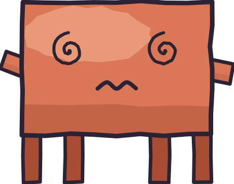
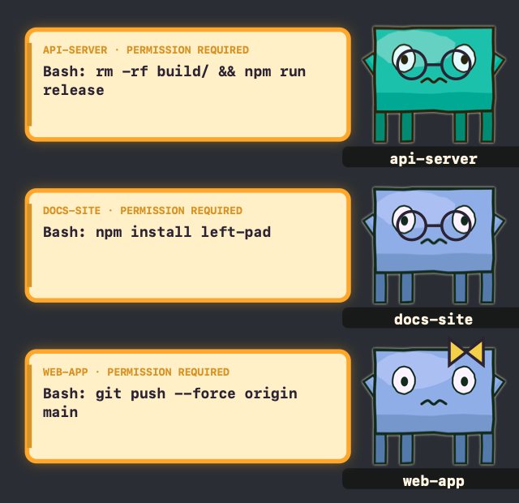
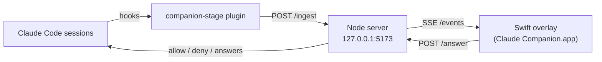

<div align="center">

&nbsp;&nbsp;
&nbsp;&nbsp;


# Claude Code Companion

**Your Claude Code sessions, performing on your desktop, waiting for your applause.**

A native macOS overlay that watches every Claude Code session you have running.<br />
When one needs you, its character walks on stage. Answer with a whip, a stamp, a cannon, or an intern.




</div>

<br />

## ✨ What it does

Claude Code stops and waits for you more often than you notice. A permission prompt in a buried terminal tab, a question, a plan to approve. The Companion puts all of it on one transparent, click-through stage over your desktop, so nothing waits unseen.

| | |
| --- | --- |
| 🎭 **One character per session** | They walk on when Claude needs you and leave once you have answered, in the terminal or on stage. |
| 🃏 **Cards, not dialogs** | Click a prompt and its options are dealt as cards on the desktop. Left-click picks, right-click flips a card to write a note on its back. |
| 🪢 **Tools you can play with** | Approve by cracking the whip. Deny with the stamp. Fire approvals with the cannon. |
| 🧑‍💼 **The Approval Intern** | Approves every prompt in every session while you get on with your day. Use with care. |
| 🔒 **Local only** | A Node server on `127.0.0.1:5173`, a Claude Code plugin that reports to it, and the Swift overlay. Nothing leaves your machine. |

## 🚀 Get started

You need macOS 14+, Node 18+ (installed with Homebrew or nodejs.org, see the note below), the Xcode command line tools (`xcode-select --install`), and Claude Code 2.1.319 or later. There is no prebuilt download: you build the app yourself.

**1. Build and launch the overlay**

```sh
git clone https://github.com/lfb0801/claude-companion.git
cd claude-companion
mac/build-app.sh --open
```

This builds `mac/build/Claude Companion.app`, a menu bar app with no Dock icon, and opens it. The app starts the Node backend from this repository if it is not already running, so **keep the clone where it is**: the path is baked into the app at build time. Move the folder and you need to rebuild.

**2. Install the plugin**, inside Claude Code:

```
/plugin marketplace add lfb0801/claude-companion
/plugin install companion-stage@companion
```

Restart any running Claude Code sessions, or start new ones. They report to the Companion from then on. That's it.

> [!NOTE]
> The app looks for Node at `/opt/homebrew/bin/node`, `/usr/local/bin/node` or `/usr/bin/node`. If you use nvm, fnm or Volta, it will not find it. Run `npm start` in the clone yourself and the app connects to that instead.

> [!TIP]
> Want to try it without Claude Code? Run `npm start` and open `http://localhost:5173/?demo` for the browser stage with three fake sessions.

## 🎮 Your tools

Global hotkeys work from any app and need no Accessibility permission.

| Hotkey | Tool | What it does |
| :---: | --- | --- |
| <kbd>⌃⌥</kbd> <kbd>W</kbd> | 🪢 **Whip** | Swing the mouse to lash a prompt and approve it. Hold the whip and click to stamp with the back of the handle. |
| <kbd>⌃⌥</kbd> <kbd>D</kbd> | 🔖 **Stamp** | Click a prompt to deny it, or request changes. |
| <kbd>⌃⌥</kbd> <kbd>G</kbd> | 💥 **Cannon** | Fires approvals at whatever it hits. |
| <kbd>⌃⌥</kbd> <kbd>H</kbd> | 🧑‍💼 **Approval Intern** | Approves everything, everywhere. |
| <kbd>⌃⌥</kbd> <kbd>X</kbd> | 🧹 Put tools away | Disarm whatever you are holding. |
| <kbd>⌃⌥</kbd> <kbd>T</kbd> | 🧰 Toolbar | Show or hide the floating toolbar. |

Muting the sound and quitting live in the menu bar icon's menu. If macOS refuses a hotkey because another app already owns it, use the toolbar buttons instead.

**No tool in hand?** Click any prompt to deal its cards. Hover a character to read its recent transcript.

## 💬 Optional: Remarc comments

If you use [Remarc](https://remarc.app) and its Claude Code plugin (version 0.13 was used here), the toolbar can link one session so your Remarc comments arrive in it as prompts, live or held back until you send them. With no session linked, the toolbar shows Remarc screenshot and note buttons. These press Remarc's own global shortcuts (<kbd>⌃⌥</kbd> <kbd>S</kbd> and <kbd>⌃⌥</kbd> <kbd>C</kbd>), which needs the Accessibility permission, so macOS asks the first time you click one. Skip all of this and nothing else changes.

## 🔀 How answering works

| Prompt | On stage | If you answer in the terminal first |
| --- | --- | --- |
| **Tool permission** | Held until you answer here or in the terminal, whichever comes first | The character leaves |
| **Question** (`AskUserQuestion`) | Options dealt as cards. The terminal shows no dialog while the stage is up | <kbd>Esc</kbd> in the terminal cancels it |
| **Plan** (`ExitPlanMode`) | A plan sheet with *Approve* and *Keep planning* | The character leaves |
| **Finished turn** | A brief "waiting for you" that leaves by itself | A new prompt clears it |

With the overlay closed, nothing is held: every prompt goes to the terminal as usual. Quitting hands any held prompts back to the terminal.

## ⚠️ Known risks

Accepted for a personal tool on your own machine. Read them before you turn the Intern on.

- **The Intern approves anything,** destructive commands included, in every session. Only `permissions.deny` rules in your Claude Code settings still stop it. A stray cannon shot approves whatever it hits.
- **No login.** The server refuses requests from other websites and other local ports (Origin and Host checks), but any program on your machine can call it.
- **Transcript format.** The hover log and terminal-answer detection read Claude Code's transcript JSONL, which is undocumented and may change.
- **Two audio clips are not MIT-licensed.** `little-friend.mp3` is a movie excerpt and `whip-summon.mp3` is a user upload from myinstants.com with no stated licence. They are third-party material, kept here for the fun of it. If you fork or redistribute this project, delete both files from `assets/audio/` and `mac/Sources/Companion/Resources/` first; the app runs fine without them. Rights holders can open an issue to have them removed. Details are in [`THIRD_PARTY_NOTICES.md`](THIRD_PARTY_NOTICES.md).
- **Not signed or notarized.** You build the app on your own machine, so Gatekeeper stays out of the way, but a rebuilt app keeps its Accessibility grant only because the build pins it to the bundle identifier.
- **Unofficial.** This is a personal project, not made by or affiliated with Anthropic. "Claude" and "Claude Code" belong to their owners, and the characters are fan art (see the notices).

## 🗺️ Under the hood



| Path | What |
| --- | --- |
| `mac/` | The native overlay: AppKit and CoreGraphics. `StageCore` holds the logic, `Companion` draws the stage |
| `plugin/` | The `companion-stage` plugin: HTTP hooks to `/ingest`, plus `hooks/ask.ts`, a mod that answers `AskUserQuestion` from the Companion |
| `server.mjs`, `companion.mjs` | HTTP server and session state, including held prompts |
| `transcript.mjs` | Transcript parsing and tailing |
| `app.js`, `theater.js`, `state.js` | The original browser stage. `/?demo` shows three fake sessions without the server or plugin |
| `spike/` | Phase 0 spike: hook behaviour findings and recording tools |
| `tests/` | `npm test` replays recorded hook payloads and transcripts from `tests/fixtures/spike/` |

## 🧰 Development

```sh
npm test                          # Node server, inbox and browser-stage tests
cd mac && swift run StageChecks   # checks for StageCore (physics, targeting, stage state)
```

Both run in CI on every push. The overlay writes the Node server's output to `~/Library/Logs/Companion/server.log`. `kill -USR1 <pid>` makes it save what it is drawing to `~/Library/Logs/Companion/snapshot.png`.

## 🗑️ Uninstall

1. Quit the app from its menu bar icon, then delete the clone and `~/Library/Logs/Companion`.
2. In Claude Code, run `/plugin uninstall companion-stage@companion` and `/plugin marketplace remove companion`.

## 📄 License

[MIT](LICENSE) for the code. The Clawd artwork and the physics approach come from MIT-licensed projects, and the two audio cues are third-party and **not** MIT. See [`THIRD_PARTY_NOTICES.md`](THIRD_PARTY_NOTICES.md).

<div align="center">
<br />
<sub>Made for people who run more Claude sessions than they have terminal tabs.</sub>
</div>
